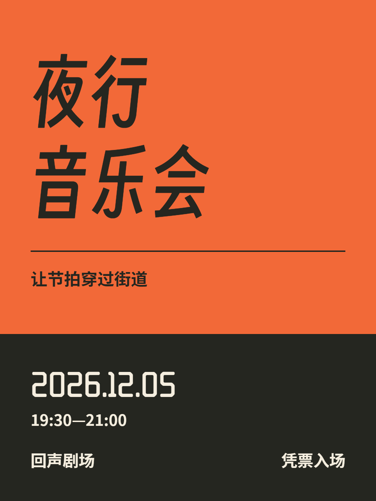
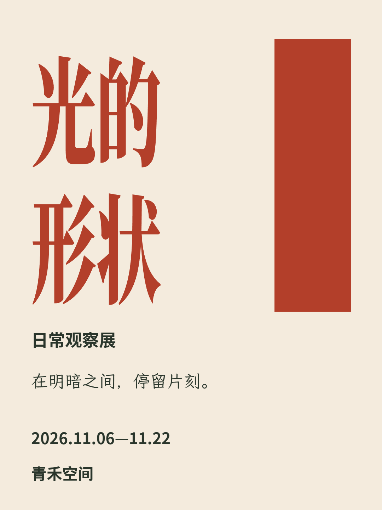

# best-layout

把正式内容排成清楚、有秩序的图片。默认结合日式编辑设计的精细文字与留白，以及瑞士设计的网格、层级和对齐。

适用于海报、封面、社媒图文、信息图和单页演示。成功制图时只展示最终位图，画面保留正式文案，不混入设计说明、参数或提示词；不生成 SVG 或 HTML 预览页。

[下载 v0.1.0](https://github.com/SalamancaDu/best-layout/releases/tag/v0.1.0) · [快速开始](#快速开始) · [使用示例](#使用示例) · [字体与排字参考](skills/best-layout/references/local-typesetting.md)

## 实际效果

以下是仓库内已生成的 PNG，正式文字由附带的真实字库排印。点击图片查看原图；示例活动均为虚构练习内容。

| 音乐会海报 | 展览海报 | 信息密集页面 |
| --- | --- | --- |
| [](tests/typesetting/concert.png) | [](tests/typesetting/light-poster.png) | [](tests/typesetting/dense.png) |
| 大标题与时间、地点分层 | 宋体表达与空间关系 | 20 项正式文案的分组与阅读顺序 |

这些示例展示不同的内容组织方式，不是每次调用都会套用的固定模板。可查看[更多样图与排字配置](tests/typesetting/)及[10 款字体检查页](tests/typesetting/selected-fonts.png)。

## 快速开始

best-layout 是给 AI 代理使用的 **Skill + 本地排字脚本**。代理负责理解内容、设计版面和检查成图，脚本负责用真实字库输出 PNG。日常使用只需提供用途和正式文案，不必手写布局 JSON。

需要能读取本地文件、运行 Python 命令并查看图片的代理环境。纯文字与几何图形无需生图模型；摄影、插画或位图修改还需要宿主提供图像生成／编辑工具。本项目不附带模型、账号或模型 API 客户端。

### 1. 下载完整技能

下载 [best-layout-v0.1.0.zip](https://github.com/SalamancaDu/best-layout/releases/download/v0.1.0/best-layout-v0.1.0.zip)（约 59 MiB），解压得到 `best-layout/`。可用同一 Release 的 [.sha256 文件](https://github.com/SalamancaDu/best-layout/releases/download/v0.1.0/best-layout-v0.1.0.zip.sha256)核对下载文件。

保留整个文件夹，包括 `SKILL.md`、`scripts/`、`references/`、`agents/`、`assets/` 和许可证。10 款字体已附带，**无需另行下载或安装到系统**。

如选择克隆源码，需要使用的是仓库内的 `skills/best-layout/`，不是仓库根目录：

```sh
git clone https://github.com/SalamancaDu/best-layout.git
cd best-layout/skills/best-layout
```

### 2. 准备排字环境

需要 **Python 3.10+、Python Playwright 和支持 Canvas `letterSpacing` 的 Chromium**。以下命令均在包含 `SKILL.md` 的技能文件夹内执行，使用代理之后实际运行脚本的同一个 Python 环境。

先检查已有环境：

```sh
python --version
python scripts/compose.py --check-env
```

看到 `Ready: Python, Playwright, Chromium Canvas` 开头的消息即可继续。若缺少 Playwright 或 Chromium，手动安装：

```sh
python -m pip install -r scripts/requirements.txt
python -m playwright install chromium
python scripts/compose.py --check-env
```

安装会下载依赖和浏览器；Skill 本身不会自动安装。已有可用的 Chrome／Edge 时，可跳过 Chromium 下载，在检查和排字命令后都加 `--channel chrome`／`--channel msedge`。已安装的其他 Chromium 可用 `--chromium "浏览器可执行文件的完整路径"` 指定。

Windows 若使用 `py` 启动 Python，将上述命令中的 `python` 一致替换为 `py -3`；macOS／Linux 通常使用 `python3`。当前实际验证为 Windows，macOS／Linux 尚未实机验证。

### 3. 先生成一张 PNG

仍在技能文件夹内执行：

```sh
python scripts/compose.py assets/examples/poster.json first-poster.png
```

成功后会输出 `first-poster.png` 的路径，打开即可看到“山川有光”与日期。这一步验证字体加载和 PNG 输出；它是固定配置的最小运行示例。自定义设计由下一步的代理完成。已有同名文件时请换文件名；明确要覆盖时再加 `--force`。

### 4. 在 Codex 中启用

将完整的 `best-layout/` 文件夹放到你要工作的项目内：

```text
你的项目/
└── .agents/
    └── skills/
        └── best-layout/
            ├── SKILL.md
            ├── scripts/
            ├── references/
            ├── agents/
            ├── assets/
            ├── LICENSE
            └── THIRD_PARTY_NOTICES.md
```

在 Codex 中打开该项目；CLI／IDE 可用 `/skills` 检查是否发现 `best-layout`，或输入 `$best-layout` 选择技能。若未出现，重启 Codex 后再检查。需要个人所有项目可用时，也可放在用户主目录的 `.agents/skills/best-layout/`，两种位置选一种即可。目录与发现方式见 [Codex 官方 Skills 文档](https://learn.chatgpt.com/docs/build-skills#where-codex-loads-local-skills)。

其他具备本地执行能力的代理，可以直接在对话里指定：“请读取并遵循 `/实际路径/best-layout/SKILL.md`，然后完成以下排版任务。”不必依赖自动发现。不要只上传 `SKILL.md`，排字脚本和字体也必须可访问。

## 使用示例

安装后向 Codex 发送以下内容；其他代理将第一行替换为技能入口的实际路径：

```text
$best-layout
制作一张 3:4 音乐会海报，用于手机信息流。
正式文案只有：
夜行音乐会
让节拍穿过街道
2026.12.05
19:30—21:00
回声剧场
凭票入场
不要增加其他文字，完成后只展示图片。
```

通常提供 **用途、画幅、准确文案** 即可；品牌色、指定字体、素材或参考图按需补充。未确定字体与构图时，交给 Skill 根据内容选择。默认完成一张 PNG，保留标题、正文、日期、数字和单位，画面不添加设计说明、提示词、字体名称或参数。

修改时说明变化和不变部分，例如：

```text
把刚才的海报改为 16:9 横版，正式文案和品牌色不变。
重新安排标题、日期和地点的位置，保持清晰可读，只展示最终图片。
```

需要更多样例可用 [测试输入](tests/cases.md)。用户明确要求诊断、方案或解释时，Skill 会提供相应文字；“只展示图片”用于成功制图交付。

## 常见问题

| 情况 | 处理方式 |
| --- | --- |
| 找不到 `python`，或版本低于 3.10 | 先准备 Python 3.10+，确认终端与代理使用同一个解释器。 |
| 提示没有 `playwright` 模块 | 用执行排字的同一个 Python 运行 `python -m pip install -r scripts/requirements.txt`。 |
| 找不到浏览器，或缺少 `letterSpacing` | 按上面的环境步骤安装 Chromium，或指定支持该能力的 Chrome／Edge。 |
| 找不到字体或 `manifest.json` | 检查是否只复制了入口文件；应保留整个技能目录及 `assets/fonts/`。 |
| 提示缺字、文字溢出或重叠 | 把错误交给代理调整字体或版面；不要删改正式文案，也不要靠压扁或缩小正文掩盖问题。 |
| 无法覆盖已有输出 | 换一个 PNG 文件名，或确认替换后加 `--force`。 |

更详细的参数、字体限制和布局配置见[真实字体排字参考](skills/best-layout/references/local-typesetting.md)。当前排字程序不支持真正的竖排、双向文本或同一文字块内混用多种字体；不要将这些能力视为已实现。

## 方法与工具

- [构图与秩序](skills/best-layout/references/composition.md)：从内容建立网格，处理留白、对比、图文关系和横竖适配。
- [文字排版](skills/best-layout/references/typography.md)：字号角色、标点、行距、字距、中英混排和真实日文。
- [图片制作与检查](skills/best-layout/references/image-production.md)：准确文案与指令分离、实际成图检查、限定范围修正。
- [来源索引](skills/best-layout/references/sources.md)：八本日本／瑞士设计参考和排版资料，逐项标明实际阅读范围。

正式文字使用附带的 10 款原始字体：思源黑体 Bold、思源宋体 Heavy、霞鹜文楷 GB、标小智无界黑、香萃等粗宋、齊伋體、得意黑、WD-XL 滑油字 SC、霞鹜漫黑、缝合像素字体 12px。字体与原始许可证约 103.5 MiB，位于技能目录内，不需安装到系统。Oswald Stencil 因所选文件的分发授权尚未确认，已从首版排除；英文／数字示例改用 WD-XL。来源、字重、适用范围及缺字限制见 [真实字体排字](skills/best-layout/references/local-typesetting.md)。

排字复用本项目已有的 Python + Playwright + Chromium 技术栈。代理形成文案与布局配置，脚本检查缺字、漏项、重复项、文字溢出和重叠，再合成 PNG。纯文字图无需生图工具；需要摄影／插画时，宿主生成无字素材后再排字。本项目不附带模型、账号或外部模型 API 客户端，不自动下载浏览器或安装依赖。

标题先从合适字库的原生比例建立表达，需要时自主倾斜、拉宽、压窄或纵向拉长；内部与原形比较后保留有效处理，变差则减弱或撤回。正文和辅助信息按阅读任务处理。变换在真实字库排印时执行，保留准确原文，并重新计算换行、对齐和边界；不要求用户逐项指定处理参数。

```sh
python skills/best-layout/scripts/compose.py --check-env
python skills/best-layout/scripts/compose.py layout.json final.png
```

可用 `--channel chrome`／`--channel msedge` 复用系统浏览器，或用 `--chromium "实际路径"` 指定。缺运行环境的安装说明见上述参考。当前验证为 Windows 本机；路径设计不依赖此电脑，尚未实测 macOS／Linux。字体文件和程序检查不能代替文案、对比度及观看尺寸核对。

## 验证

[测试输入](tests/cases.md) 包含原有四例，以及正常调用的音乐会海报、20 项完整文案的手机活动指南、指定高饱和品牌色的纯文字海报。[验证记录](tests/validation.md) 保留失败首稿、修正过程、最终图片和手机显示截图，区分结构检查与实际观察。

当前真实字体路径另有 [7 张排字作品与换行用例](tests/typesetting/)、[10 款字库检查页](tests/typesetting/selected-fonts.png)、[排字回归](tests/test_typesetting.py)和 [发布包测试](tests/test_release.py)。包括按用户反馈恢复原生比例、减轻倾斜的[夜跑海报](tests/typesetting/forward-poster.png)，以及压窄拉高的[观察展海报](tests/typesetting/light-poster.png)。回归覆盖字体加载、文案完整性、成对省略号／破折号、数字与前后缀、中文组合单位、词内撇号、不换行空格、变换后的换行／对齐／边界、缺字／溢出拦截、透明合成及未变形文字的像素保持；发布测试从解压目录验证运行和同一组换行用例，并确认失败任务不会替换已有图片。普通测试不覆盖已审阅的样图。夜跑初稿虽通过技术检查，仍因字形过扁被用户否定，过程见验证记录。

[显示检查脚本](tests/inspect_images.py) 使用本机已有的 Pillow、Playwright 和 Chromium，直接打开 PNG 并截取指定显示宽度的图片；不修改原图、不安装依赖，也不自动判断文案或设计通过。它仅供开发验证，技能运行不依赖这个脚本。

```powershell
python -X utf8 tests/inspect_images.py tests/outputs/repair-guide.png --width 390 --output-dir tests/inspection
```

若当前 Playwright 没有默认浏览器路径，用 `--chromium "已安装的 Chromium 可执行文件路径"` 指定。本次实际检查了 390 像素宽，密集页另检查了 360 像素宽；这些是浏览器显示模拟，不是真机或用户盲测。

本仓库维护任务可以报告文件与验证结果；“只展示图片”约定用于 Skill 的成功制图交付。示例的研究与验证记录不会写进最终图片。

## 维护与本地打包

```sh
python scripts/build_release.py
```

输出 `dist/best-layout-v0.1.0.zip` 及同名 `.zip.sha256`，需要重建已有包时加 `--force`。脚本只在本地打包，不上传、安装、提交或发布。解压后得到完整的 `best-layout/`，可复制到宿主支持的 Skill 目录，或直接引用其中的 `SKILL.md`。环境准备及命令见包内 `references/local-typesetting.md`；`assets/examples/poster.json` 可用于首次运行。

包内只有技能入口、Codex 配置、参考文档、排字脚本、最小示例、10 款原始字体及许可证。打包时核对许可、字体哈希和内部链接，未列入清单的字体会阻止打包。未携带 Python、Playwright、浏览器、研究下载、历史样图或测试缓存，首次使用仍需具备运行环境。公开源码时不要手工加入已忽略的 `tests/font-specimens/`；其中保留了历史候选与未确认授权的研究原件。

维护检查复用本机已有的 Pillow、Playwright 与 Chromium；测试依赖未随技能打包：

```sh
python -X utf8 tests/test_typesetting.py
python -X utf8 tests/test_release.py
```

若没有默认浏览器，先将 `BEST_LAYOUT_CHROMIUM` 设为已安装的 Chromium 可执行文件。当前实测范围是 Windows，本地解压运行不等于干净机器安装或跨平台验收。

## 许可证

原创代码、Skill 与文档采用 [MIT](LICENSE)。字体另按各自的 OFL-1.1 分发，版权和许可清单见 [第三方说明](skills/best-layout/THIRD_PARTY_NOTICES.md)。独立技能目录也保留 MIT 副本，复制该目录不会漏掉项目许可。[Oswald Stencil 复核记录](tests/oswald-stencil-license-review.md)说明了首版排除依据。
