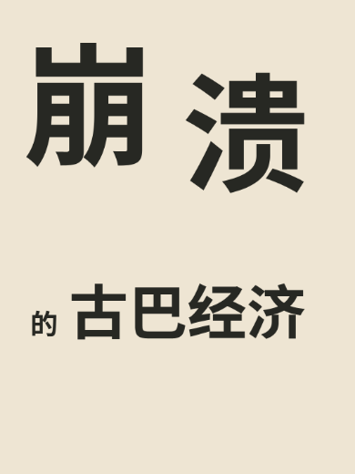
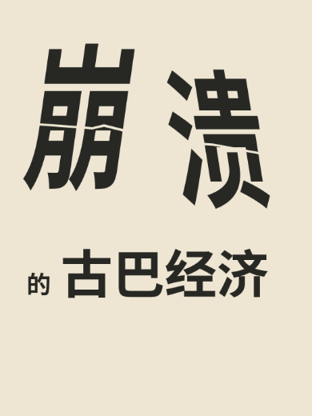

# 字体选择与修改反馈实测

这组案例始于 v0.1.1 本地优化，相关修正现收拢到 v0.1.2。记录区分字体资源、表达判断与程序通过；判断由当前代理自审，不是独立盲测或用户审美验收。复用用户测试的无字插画，没有重新生图、添加经济数据或经济现状结论。

## 古巴经济：先隔离字体，再调整关系

正式文案只有“古巴经济”。[基准配置](cuba-baseline.json)保留首版的字号、位置、颜色、分行及素材。

```sh
python skills/best-layout/scripts/proof_fonts.py tests/typography/cuba-baseline.json 新的输出目录 --copy-id title --fonts source-han-serif xiangcui wdxl unbounded
```

[四种字体对照](font-proofs/)不标字体名、不添加其他文字，内部 [proofs.json](font-proofs/proofs.json)记录原文和实际排字。

| 对照 | 实际观察与取舍 |
|---|---|
| [思源宋体 Heavy](font-proofs/source-han-serif.png) | 横竖对比与锋利收笔延续出版感，保留骨架继续试排。首版是可读的中性排版；首个模糊主题请求不等于已经要求张力。 |
| [香萃等粗宋](font-proofs/xiangcui.png) | 较轻、笔端更有书写笔意，与插画可以协调；本标题中更温和，单纯换字库没有带来所需关系。 |
| [WD-XL](font-proofs/wdxl.png) | 圆角管线感突出，和旧建筑印刷质感衔接较弱，本次未选。 |
| [无界黑](font-proofs/unbounded.png) | “经济”密笔部分拥堵，块面厚重，未选为本次张力方向；下方强调案例仍有适用角色。 |

[用户拒绝的加粗稿](cuba-rejected-heavy.png)及[配置](cuba-rejected-heavy.json)保留，不能标为审美通过。

先生成[思源宋体两行重排](cuba-source-han-serif-reflow.png)和[香萃两行重排](cuba-xiangcui-reflow.png)。虽然改变宽高和偏移，结构仍较平。继续用思源宋体把四字拆为准确文字块，调整两组相反的高低与收放关系：[当前保留稿](cuba-counterforce.png)、[配置](cuba-counterforce.json)、[排字检查](cuba-counterforce-checks.json)。四块按“古、巴、经、济”拼接仍等于原文；背景、配色和下方插画保留，y≥600 区域与基准的实际像素一致。没有局部主笔重绘或磨损，不把本稿描述为已实现这些效果。

代理自审：保留稿的笔画与字腔比加粗稿清楚，高低关系和留白收放比均匀两行更明确；是否达到用户期望的张力强度仍需用户判断。已检查原图与 [390px](inspection/cuba-counterforce-390.png)，对照[首版](inspection/source-han-serif-390.png)和[加粗稿](inspection/cuba-rejected-heavy-390.png)。PNG 成功输出不等于审美通过。

## 区分强调与精密

以下为原创练习内容，日期不代表真实活动。

| 输入与目标 | 实际结果 |
|---|---|
| “把”“重点”“留给内容”“城市观察｜2026.10.18”；只强调“重点” | [强调稿](emphasis.png)、[配置](emphasis.json)、[390px](inspection/emphasis-390.png)。无界黑只承担强调词，大小与颜色形成相对差异，其他文字保留阅读角色；四项原文准确。 |
| “城市观察”“空间与秩序”“01  比例”“由尺度建立关系”“02  间距”“在分组之间停顿”“03  方向”“让视线找到路径”“2026.10.18”；表达精密的编辑秩序 | [精密稿](precision.png)、[配置](precision.json)、[390px](inspection/precision-390.png)。规则线、共同轴线与三组等距关系承担秩序，数字与栏目有固定角色；九项原文、双空格及日期准确，无立体、金属或科幻装饰。 |

均查看原图和 390px 显示，能读出全部正式内容。编号是正式练习内容，图片没有方案名称、字体名称、参数或制作标注。前述测试未覆盖真正的笔画改造、材料剥蚀或独立上下文选字；下节针对用户再次指出的文字设计不足继续修正。

## 文字承担表达：崩溃的古巴经济

用户第二次实测仍直接选择思源宋体，配置没有字形变换，主要由破败摄影与失墨承担情绪。上一轮“古巴经济”比较偏重配图与字体气质，不能据此认定文字设计问题解决。

本轮将正式文案锁定为“崩溃的古巴经济”，移除全部摄影、插画与做旧纹理，先做[五款字体试排](text-first/font-proofs/)。思源宋体横竖反差强、香萃笔意较柔、得意黑自带斜向、无界黑墨色过密；本例选择思源黑体 Bold 作为较中性的结构底子，后续设计不是直接套用原形。

| 原形对照 | 比例、方向与局部处理候选 |
|---|---|
| [](text-first/native-control.png) | [](text-first/title-designed.png) |

本次实际处理：“崩”横向 0.91、纵向 1.35、向右倾斜 8°；“溃”横向 0.87、纵向 1.32、向左倾斜 9°，两字有相反方向和高低关系。将“的”连接到“古巴经济”同一行，以相同基线保留整句的阅读关系。具体数值是此例设计，不写成通用配方。

先检查[无表面效果的几何稿](text-first/geometry.png)，再在真实文字的透明层上设计一条局部折线裂口，跨过指定墨迹，得到[处理稿](text-first/title-designed.png)。[配置](text-first/ink-cuts.json)与[处理报告](text-first/title-designed-checks.json)保留源 PNG 哈希、正式文案及实际变换；改变了 3554 个 alpha 像素，保留墨量约 98.65%。没有随机撒噪点、重画文字或修改字库。该比例只描述损伤量，不代表审美分数。

原尺寸和 390px 显示均已实际检查：标题能逐字读出，裂口没有删掉必要部件；相反倾斜和纵向伸展在移除图片后仍可辨认。裂口是有意结构缺损的功能示例，不能声称已模拟自然旧印刷材料，也不把此候选视为用户验收过的最终海报。字形轮廓重构与后续独立调用表现尚未验证。

## 程序证据

v0.1.2 于 2026-10-19 重新执行以下 36 项回归，全部通过；这是本机程序验证，不替代上方的视觉判断或用户验收。

- `tests/test_typesetting.py`：23 项通过，覆盖原有排字、换行、变换与文案检查。
- `tests/test_font_proofs.py`：4 项通过，检查跨目录试排、相对素材、正文像素保持、准确原文、缺字／溢出失败和拒绝覆盖。
- `tests/test_ink_cuts.py`：3 项，验证实际 alpha 缺损、未处理区域保持、准确源图关联、非法与无效蒙版失败、拒绝覆盖。
- `tests/test_release.py`：6 项，包括从独立解压目录运行字体试排与透明标题缺损工具。

字体、许可证与原有渲染器未修改；新增程序复用现有 Playwright／Chromium，不增加运行依赖。GitHub 正式发行仍是 v0.1.0，本地维护版的验证不表示已经发布。
